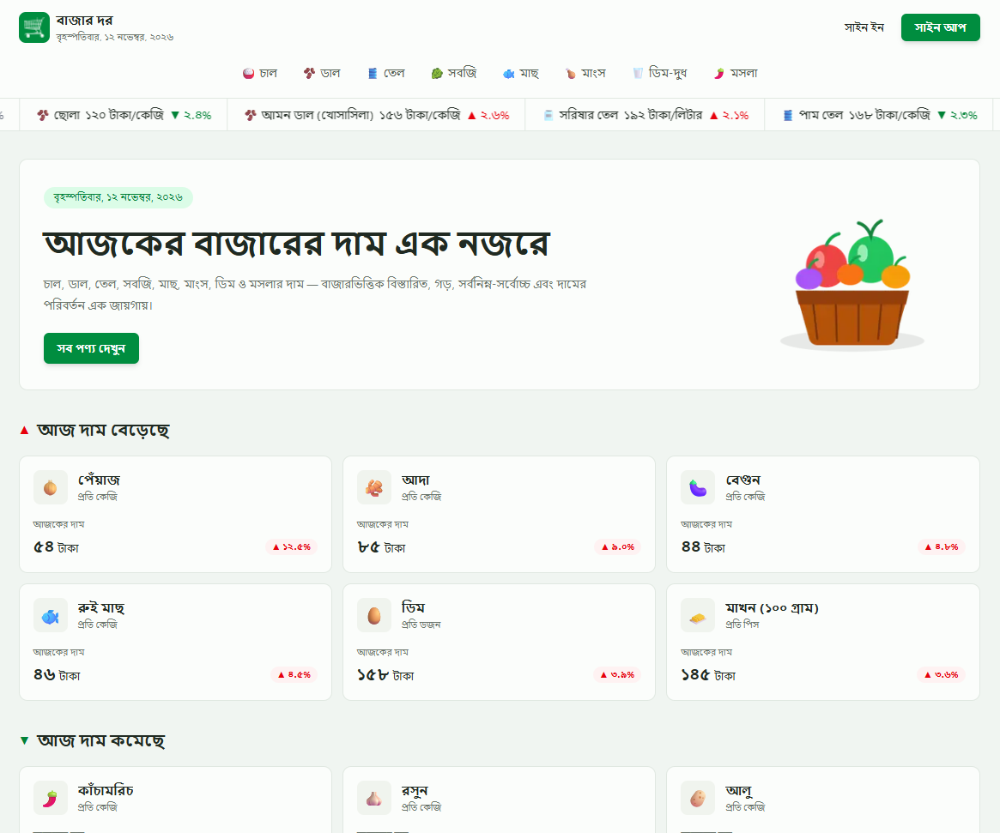
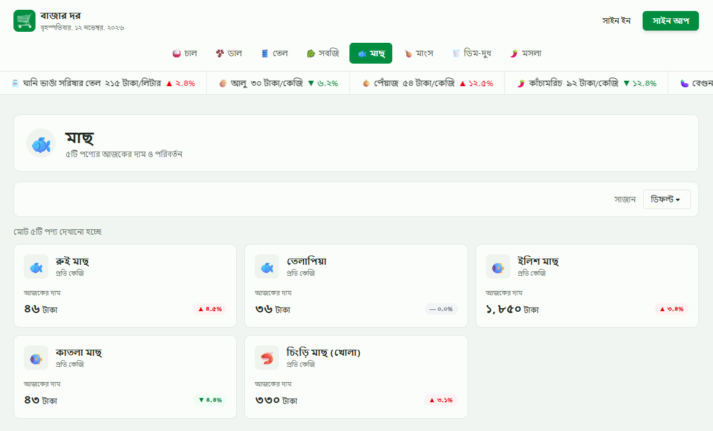
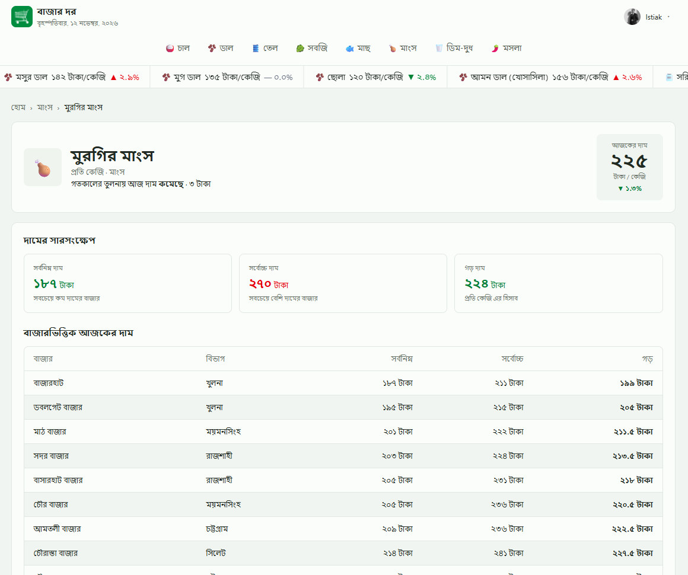

# 🛒 বাজার দর (Bazar Dor)



A Bengali market-price tracker for everyday groceries in Bangladesh. You can check today's prices for rice, lentils, oil, vegetables, fish, meat and more, see how much each price changed, and compare prices across markets after signing in.

**🔗 Live site:** https://bazar-dor-tau-eight.vercel.app

---

## 📌 Overview

Prices at Bangladeshi bazars change every day, and shoppers rarely know whether a price is fair. **Bazar Dor** puts daily prices in one place, in Bengali. A live ticker and "top risers / fallers" sections show at a glance what got more expensive. Signed-in users can open any product to see its minimum, maximum and average price across different markets.

---

## ✨ Key Features

- 🇧🇩 **Fully Bengali interface:** product names, prices, units, percentage changes and dates.
- 📈 **Live price ticker:** an infinite-scrolling bar of prices and changes.
- 🔺 **Top risers & fallers:** the six biggest price increases and decreases.
- 🗂️ **8 categories:** rice, lentils, oil, vegetables, fish, meat, eggs & dairy and spices, with low-to-high and high-to-low price sorting.
- 🔒 **Protected product details:** minimum, maximum and average prices across markets, for signed-in users.
- 🔐 **Authentication:** email/password, Google and GitHub login with Better Auth, sessions stored in MongoDB.
- 👤 **Profile page:** view your account and update your name.
- ✅ **Validated API data:** product responses are checked with Zod, with a fallback API, request timeouts and 60-second revalidation.
- ⚡ **Polished UX:** loading skeletons, toast notifications, error pages and friendly 404s, fully responsive.

---

## 📸 Screenshots

| Category page | Product details |
|---|---|
|  |  |

---

## 🛠️ Tech Stack

| Technology | Purpose |
|---|---|
| **Next.js 16** (App Router) | Routing, server rendering and API routes |
| **React 19** + **TypeScript** | UI and type safety |
| **Tailwind CSS 4** + **DaisyUI 5** | Responsive styling and components |
| **Better Auth** | Email/password, Google and GitHub authentication |
| **MongoDB** | User and session storage |
| **Zod** | Product API response validation |
| **React Hot Toast** · **React Icons** | Notifications and icons |
| **Vercel** | Hosting |

---

## 📦 Dependencies

```text
next 16.4.0                 react / react-dom 19.3.0
better-auth ^1.7.7          @better-auth/mongo-adapter ^1.7.7
mongodb ^7.7.0              zod ^4.6.7
react-hot-toast ^2.6.1      react-icons ^5.7.0
server-only ^0.0.1
```

**Dev:** typescript ^5 · tailwindcss ^4.3.3 · daisyui ^5.7.47 · eslint ^9 · babel-plugin-react-compiler

---

## 🚀 Run Locally

**Prerequisites:** Node.js 20+, a free [MongoDB Atlas](https://www.mongodb.com/atlas) cluster and, optionally, Google/GitHub OAuth apps for social login.

1. **Clone the repository**
   ```bash
   git clone https://github.com/Istiak0614/bazar_dor.git
   cd bazar_dor
   ```

2. **Install dependencies**
   ```bash
   npm install
   ```

3. **Create a `.env.local` file** in the project root:
   ```env
   BETTER_AUTH_SECRET=your_long_random_secret
   BETTER_AUTH_URL=http://localhost:3000

   MONGODB_URI=your_mongodb_atlas_connection_string
   MONGODB_DB=bazar_dor

   GOOGLE_CLIENT_ID=your_google_client_id
   GOOGLE_CLIENT_SECRET=your_google_client_secret
   GITHUB_CLIENT_ID=your_github_client_id
   GITHUB_CLIENT_SECRET=your_github_client_secret

   PRODUCT_API_URL=https://openapi.programming-hero.com/api/bazardor
   PRODUCT_API_FALLBACK_URL=https://api.abcz.workers.dev/api/bazardor
   ```
   Generate a secret with:
   ```bash
   node -e "console.log(require('node:crypto').randomBytes(32).toString('hex'))"
   ```

4. **Start the development server**
   ```bash
   npm run dev
   ```

5. Open **http://localhost:3000**

<details>
<summary><b>Setting up Google & GitHub login (optional)</b></summary>

**Google:** in [Google Cloud Console](https://console.cloud.google.com/apis/credentials), create an OAuth client of type *Web application*:
- Authorized JavaScript origin: `http://localhost:3000`
- Authorized redirect URI: `http://localhost:3000/api/auth/callback/google`

**GitHub:** in [GitHub → Settings → Developer settings → OAuth Apps](https://github.com/settings/developers), create a new app:
- Homepage URL: `http://localhost:3000`
- Callback URL: `http://localhost:3000/api/auth/callback/github`

Copy each client ID and secret into `.env.local`, then restart the server.
</details>

### Available scripts

| Command | Description |
|---|---|
| `npm run dev` | Start the development server |
| `npm run build` | Create a production build |
| `npm run start` | Run the production build |
| `npm run lint` | Run ESLint |

---

## 🧭 Routes

| Route | Access | Description |
|---|---|---|
| `/` | Public | Ticker, hero, top risers/fallers and all products |
| `/category/[slug]` | Public | Products in a category with price sorting |
| `/product/[slug]` | Signed in | Market-by-market prices with min, max and average |
| `/signin`, `/signup` | Public | Email/password and social login |
| `/profile` | Signed in | Account information |
| `/profile/update` | Signed in | Update your name |

---

## 📊 How Prices Are Calculated

- **Top risers / fallers:** products sorted by the size of their percentage change, six per section.
- **Minimum / maximum:** the lowest minimum and highest maximum across all listed markets.
- **Average:** the mean of each market's midpoint, `(min + max) / 2`.
- **Colours:** green for price increases, red for decreases and grey for unchanged prices.

> Prices come from an external API and are indicative. Actual prices may differ between markets.

---

## 📁 Project Structure

```text
src/
├── app/
│   ├── page.tsx                 # Home
│   ├── category/[slug]/         # Category pages
│   ├── product/[slug]/          # Protected product details
│   ├── profile/                 # Profile + update
│   ├── signin/ · signup/        # Auth pages
│   └── api/auth/[...all]/       # Better Auth handler
├── components/                  # Navbar, Ticker, Hero, ProductCard, AuthForm, …
└── lib/                         # API client, Zod schemas, auth, session, helpers
```

---

## 🔗 Links

- **Live site:** https://bazar-dor-tau-eight.vercel.app
- **Repository:** https://github.com/Istiak0614/bazar_dor
- **Author:** [Md. Istiak Hossain Ifti](https://www.linkedin.com/in/md-istiak-hossain-ifti/)
